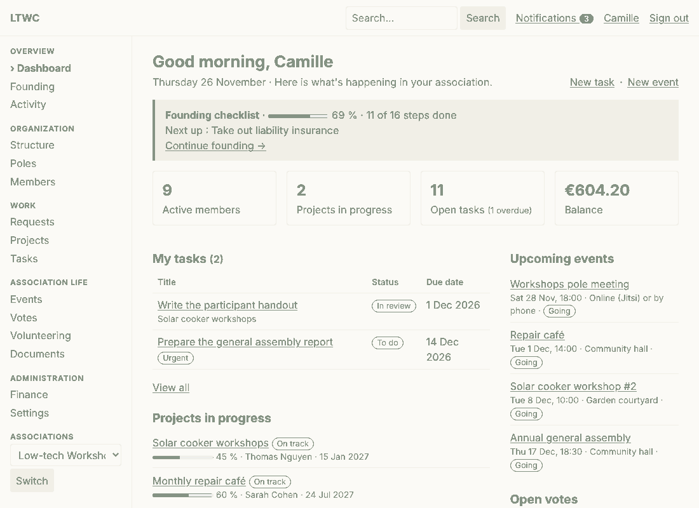
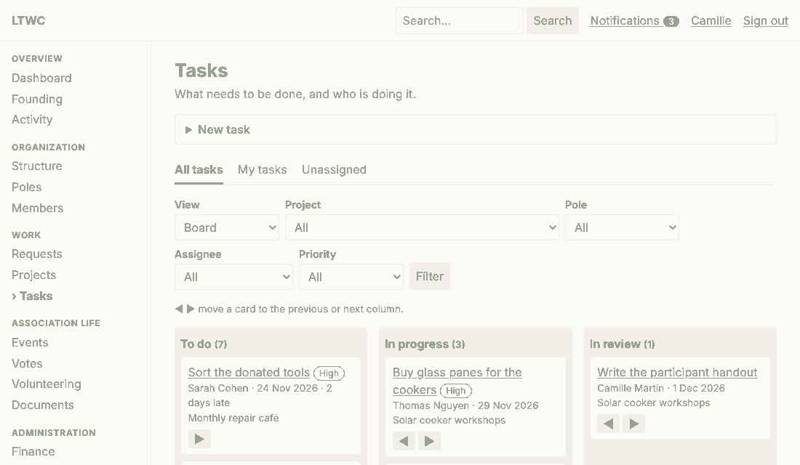
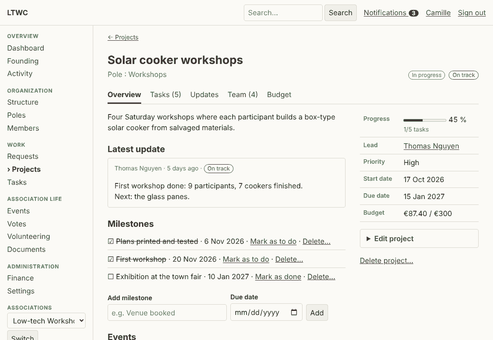
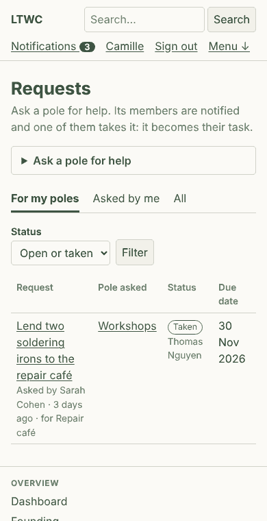

# Agora low-tech

**The workspace of your association, rebuilt to be useful, accessible and sustainable.**

Founding checklist, structure, poles, requests between poles, projects, tasks, events, votes, volunteering,
finance, documents and members, in English and French. It runs on PHP and a single SQLite file, with
**no dependencies, no build step and no JavaScript**.



---

## Why a low-tech version?

[Agora](https://github.com/EEmeka33/agora) started as a modern web application: Next.js, React, Prisma and
Tailwind. It worked well, but it needed 1.2 GB of dependencies, a build step, hundreds of megabytes of memory
on the server, and about half a megabyte of downloads per page.

This version keeps the features and drops the weight. It was written for an association that practises
low-tech, and as a teaching example for a course on low-tech.

|                                        | Original (Next.js)            | Low-tech (PHP + SQLite)                   |
| -------------------------------------- | ----------------------------- | ----------------------------------------- |
| Dependencies to install                | 590 packages, 1.2 GB          | **0**                                     |
| Build step                             | 16 s, 109 MB output           | **none**                                  |
| Source code                            | ~20,000 lines (TS, TSX, CSS)  | **~8,500 lines** (PHP, CSS, SQL)          |
| Downloaded per page, empty cache       | 445–610 KB, 58–72 requests    | **6–8 KB, 2 requests**                    |
| … of which JavaScript                  | 300–450 KB                    | **0**                                     |
| Downloaded per page, cached stylesheet | ~120 KB, 73 requests          | **3.5 KB**                                |
| Server CPU time per page               | 21–26 ms                      | **1.6–1.7 ms**                            |
| Server memory                          | ~290 MB (950 MB after a load test) | **~20 MB per PHP worker, 0 when idle with PHP-FPM** |
| Runs on                                | a VPS with Node.js 20+        | any PHP 8.1 host, a Raspberry Pi, an old laptop |

How these numbers were measured, and what they mean (and don't), is explained in
[docs/low-tech.md](docs/low-tech.md#measurements).

## Features

Everything the original does, with plain HTML forms instead of client-side code:

| | |
| --- | --- |
| **Founding checklist** | 16 steps from the purpose to the bank account (statutes, constitutive assembly, declaration, insurance…), assignable, with progress per theme. |
| **Structure** | Organization chart (association → board → poles), **who does what** (recurring duties), membership matrix. |
| **Poles** | Working groups with leads and members, their projects, tasks, requests, duties and events. |
| **Requests** | Ask a pole for help: its members are notified, one of them clicks **Take it** and the request becomes their task. The requester is notified when it is taken and when it is done. |
| **Projects** | Lead, team, dates, budget, milestones, progress updates, automatic progress and health, a **timeline** drawn as a table. |
| **Tasks** | A board (one column per status, ◀ ▶ buttons to move cards), a list, filters, comments, due dates. |
| **Votes** | Single or multiple choice, anonymous or not, closing date, restricted to a pole if needed. Results drawn with text characters. |
| **Volunteering** | Members log their time (`1h30`, `45min`…); totals per member and pole, estimated value, CSV export for grant applications. |
| **Events & meetings** | General assemblies, board meetings, workshops. Month calendar, RSVP, agenda, **minutes you can print**, private **iCalendar feed**. |
| **Finance** | Income and expenses, a monthly chart in text, project budgets, membership fees, CSV export. Visible to every member, managed by managers. |
| **Documents** | Files and links by category; **big photos are reduced automatically** on upload. |
| **Members** | Roles (administrator, manager, member), board positions, activation links, **join codes** with a limited number of uses. |
| **Notifications** | In the app, and by email: **one daily summary** (default), every notification, or none. |
| **Several associations** | One Agora hosts several associations; each person switches between theirs; data never crosses. |

What changed on the way is listed, with the reason for each choice, in
[docs/low-tech.md](docs/low-tech.md#what-changed-and-why).

<table>
  <tr>
    <td></td>
    <td></td>
    <td width="200"></td>
  </tr>
</table>

## Quick start

You need **PHP 8.1 or newer** with the SQLite extension (`php -m | grep sqlite`). Nothing else.

```bash
git clone https://github.com/EEmeka33/agora-lowtech.git && cd agora-lowtech
php -S localhost:8080 -t public public/index.php
```

Open http://localhost:8080, **create your account**, then **create your association**. The database is
created on the first visit, in `data/agora.db`.

Want to look around first? Load the demo, a low-tech workshop association (add `--fr` for French):

```bash
php bin/seed.php
```

Sign in with `camille@lowtech.example` / `agora-demo-2026`. Other accounts: `yanis@`, `lea@`, `thomas@`,
`ines@`, `lucas@`, `sarah@lowtech.example`, with the same password. Join code: `MAKER-SPACE`.

To keep it running for real (shared hosting, Raspberry Pi, old laptop, VPS), read
[docs/self-hosting.md](docs/self-hosting.md).

## Documentation

| | |
| --- | --- |
| 🌱 [Low-tech: choices, measurements, course material](docs/low-tech.md) | Why each choice was made, before/after measurements, exercises |
| 📘 [User guide](docs/user-guide.md) | How each part of Agora works |
| 🖥️ [Self-hosting](docs/self-hosting.md) | Shared hosting, Raspberry Pi, VPS; email, HTTPS, backups, updates |
| 🧱 [Architecture](docs/architecture.md) | How the code works, and how to change it |
| 🔐 [Security](SECURITY.md) | What is protected and how |

## Commands

| Command | What it does |
| --- | --- |
| `php -S localhost:8080 -t public public/index.php` | Development server |
| `php tests/run.php` | All tests: unit tests and an end-to-end story, including the low-tech budget (about 3 s) |
| `php bin/seed.php [--fr] [--reset]` | Demo data |
| `php bin/backup.php [folder]` | Backup of the database and the files, safe while running |
| `php bin/maintenance.php` | Daily digests and cleanup (Agora also runs it by itself every hour) |
| `php bin/check.php` | Checks that the server can run Agora |
| `php bin/create-admin.php email` | Gets you back in if nobody can sign in |

## License

No license has been chosen yet. Before others reuse the code, add a `LICENSE` file:
[AGPL-3.0](https://choosealicense.com/licenses/agpl-3.0/) (like Paheko) makes anyone who hosts a modified
version share their changes; [MIT](https://choosealicense.com/licenses/mit/) lets anyone reuse it freely.
